# MC fabric端开服教学

首先去[Minecraft 启动器安装 |fabric](https://fabricmc.net/use/installer/)下载windows版客户端

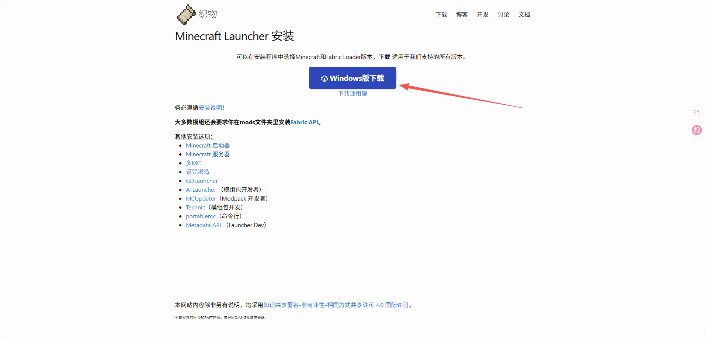

双击打开后选择服务端

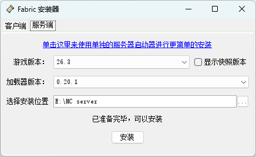

这个界面分别可以选择游戏版本，fabric加载器版本和安装位置，一般默认是这个安装器所在的文件夹，点击安装即可开始安装

接下来它会自动下载必要的库以及fabric服务端

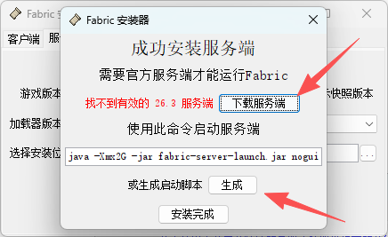

安装完成后需要点击下载官方服务端，然后可以选择生成启动脚本

~~~bash
java -Xmx2G -jar fabric-server-launch.jar nogui
pause
~~~

以上是默认的启动脚本，我们拆开来看：

### `java`

调用 Java 运行时。服务端必须用对应版本的 Java（比如 1.20.5+ 需要 Java 21，1.18~1.20.4 通常 Java 17）。

### `-Xmx2G`

设置 **Java 堆内存的最大值**为 2GB。`Xmx` 是 "maximum heap size"。

- 常见还有 `-Xms2G` 设置初始堆大小，通常建议 `-Xms` 和 `-Xmx` 设成一样，避免堆反复伸缩。
- 2G 对原版小服够用，但加模组/插件多、玩家多时往往不够，容易 OOM 或频繁 GC 卡顿。可以根据模组数量和服务器硬件配置来调整。

### `-jar fabric-server-launch.jar`

告诉 Java 要运行哪个 **jar 包**。这里是 Fabric 服务端的启动器 jar。换成 Paper 就是 `paper-xxx.jar`，Forge 则是 `forge-xxx.jar` 或 `run.bat` 里的启动类。

### `nogui`

传给 Minecraft 服务端的参数，表示 **不启动图形界面**（Swing 窗口）。服务器环境通常没有显示器，必须加这个；不加在某些系统上会报错或白开一个窗口。

如果没有这一行会有一个gui，长这样的

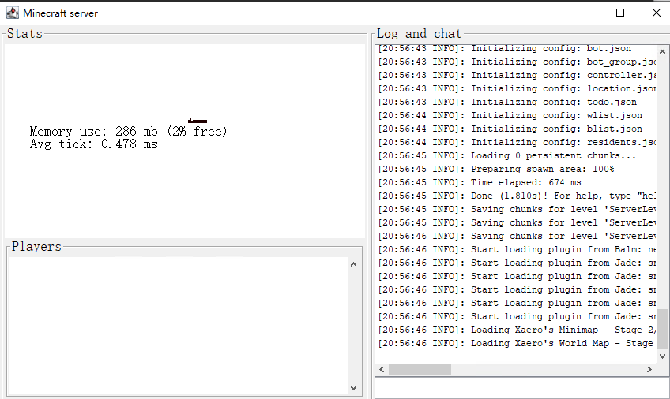

### `pause`

这是 **Windows 批处理（.bat）命令**，不是 Java 参数。作用是脚本执行完后**暂停，等待按任意键**，防止双击运行后窗口一闪而过看不到报错。Linux 的 `.sh` 脚本里没有这个。

一般我用的是

~~~bash
chcp 65001
"D:\26.3\java-runtime-epsilon\bin\java.exe" -Xmx6G -jar fabric-server-launch.jar nogui
pause
~~~

### `chcp 65001`

**把当前控制台代码页切换为 UTF-8**（65001 是 UTF-8 的代码页编号）。在 Windows 的 `.bat` 启动脚本里常见这行，通常和 `-Dfile.encoding=UTF-8` 配合使用，目的是让控制台正确显示中文等非 ASCII 字符，避免乱码。

### `"D:\26.3\java-runtime-epsilon\bin\java.exe"`

这个是我指定用某个特定的java来启动服务器，比如minecraft26.3需要使用 Java 25 或更高版本，要是想偷懒可以去PCL看你客户端用的啥java版本，可以复制一份到服务器所在的文件夹用来启动

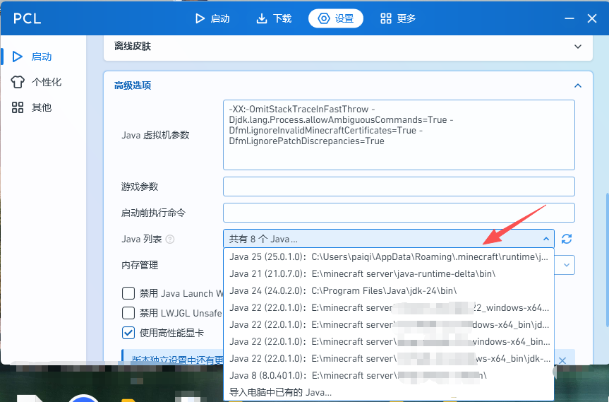

接着双击start.bat即可启动服务器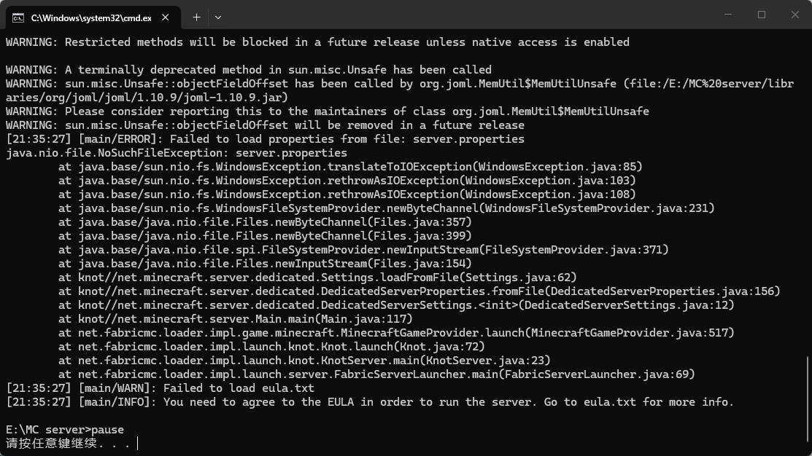

第一次启动需要去eula.txt设置EULA为true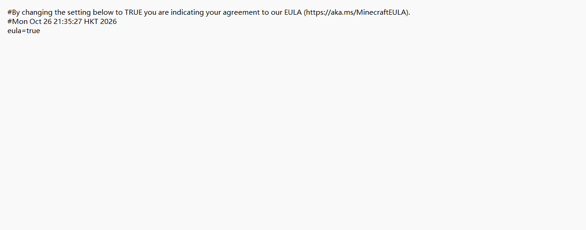

然后在server.properties把white-list=true改为false（关闭白名单，不然进不去服务器），如果都是离线玩家可以online-mode=true改false关闭正版验证，如果有正版也有离线玩家，或者怕离线玩家直接改名直接顶号，可以给服务器加一个[EasyAuth - Minecraft Mod](https://modrinth.com/mod/easyauth)模组（正版验证得开着），下载后直接放到服务器的mod文件夹里面再启动服务器，这样离线玩家就可以/reg 密码 密码 来进行注册，/l 密码 来进行登录，正版玩家则进行正版验证，验证通过后可以直接开玩。

接着再双击start.bat即可启动服务器，服务器默认是开在本地的0.0.0.0:25565，关服的话输入命令/stop即可，要联机的话还需要进行**内网穿透**或者是用**Radmin**在局域网进行联机。

**内网穿透**新手建议可以使用openfrp，去[OpenFrp Next](https://console.openfrp.net/dashboard)注册、实名认证，然后下载客户端，在官网每天签到即可领取流量。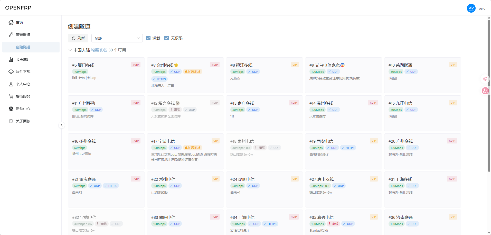

点击创建隧道，选择一个可用的节点，本地端口填写25565，隧道类型选TCP，其他都点随机到合格为止，然后创建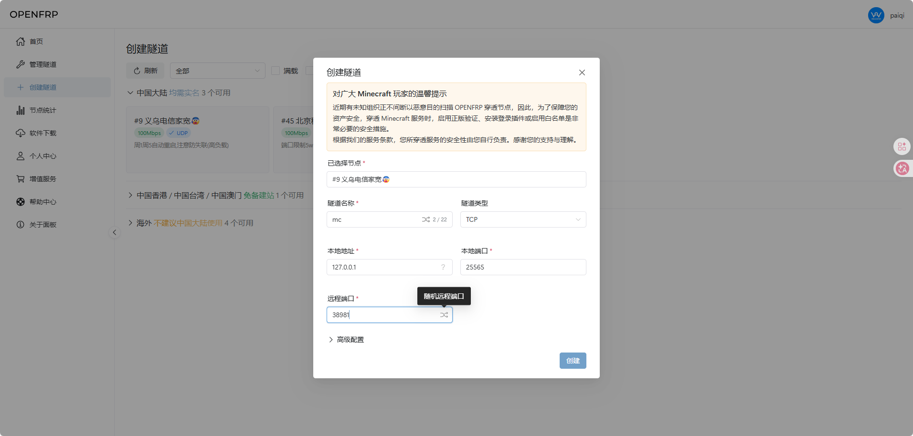

下载客户端后在客户端登录刚刚的账号，然后打开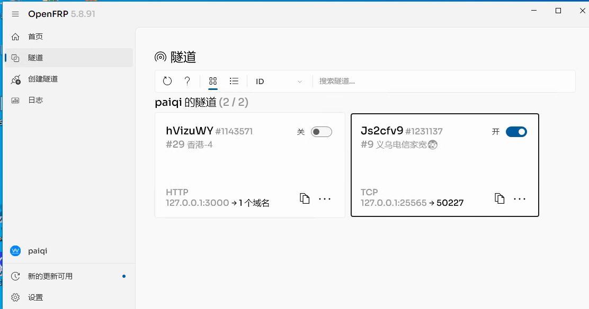

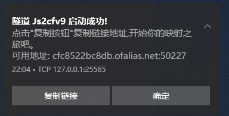

启动后去mc里面直接填入这一整串链接即可进入服务器了

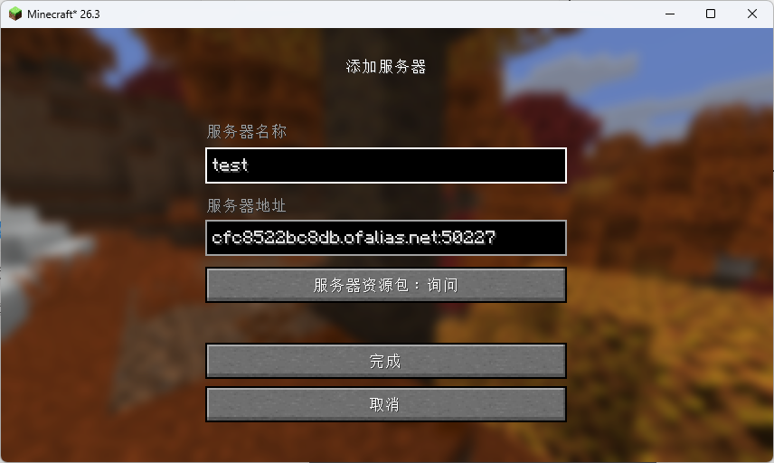

如果是自己有其他带有公网ip的云服务器，可看[MC内网穿透教程 | MCpaiqi 的博客](https://bqblog.pages.dev/reference/mc-tunnel.html)