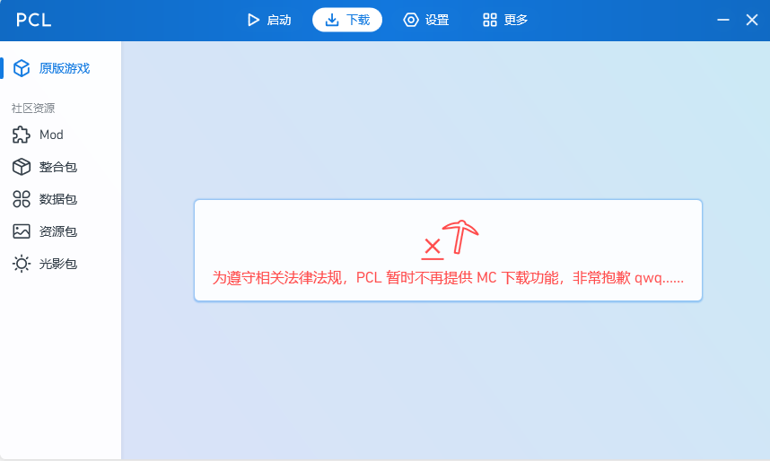
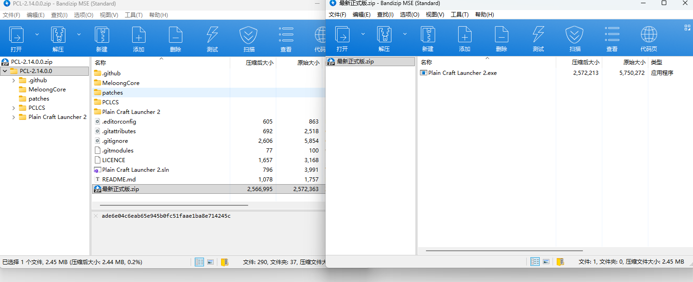
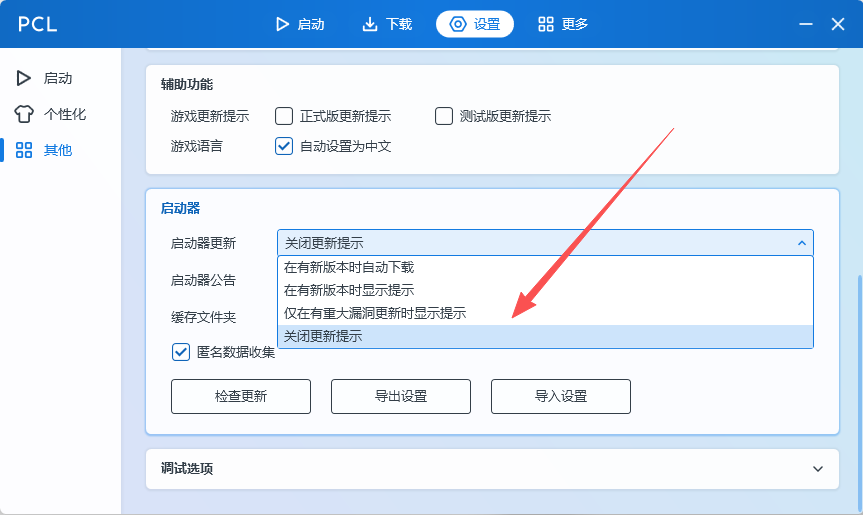
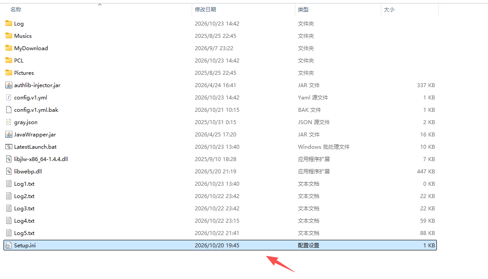
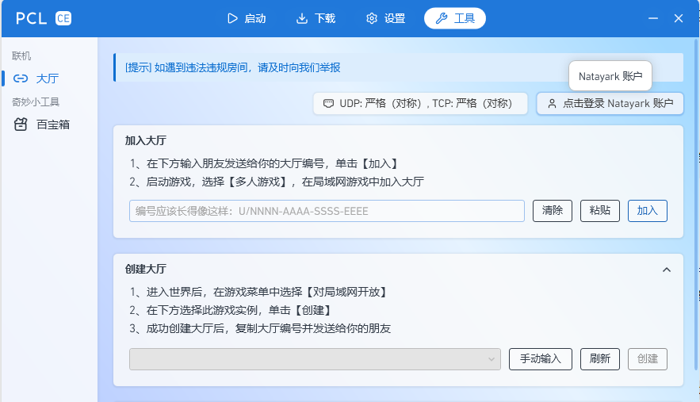
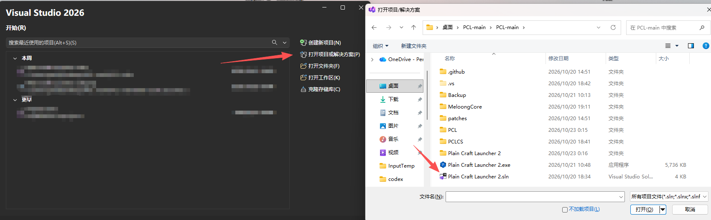
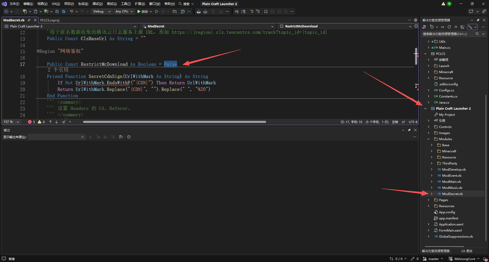
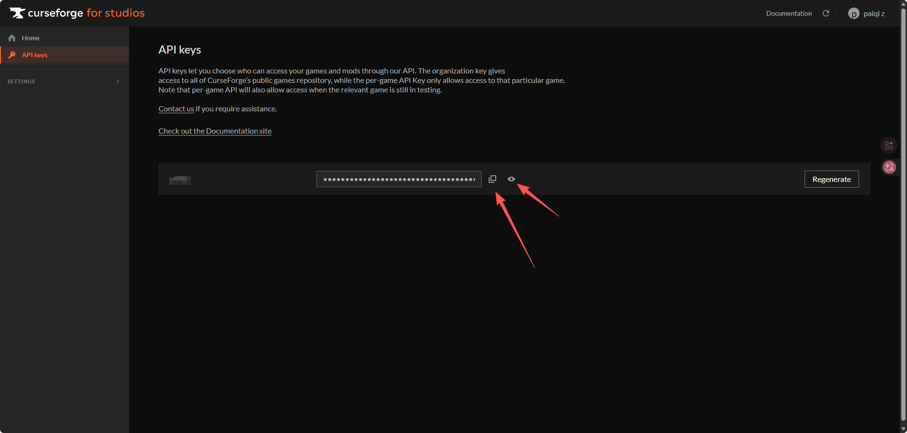
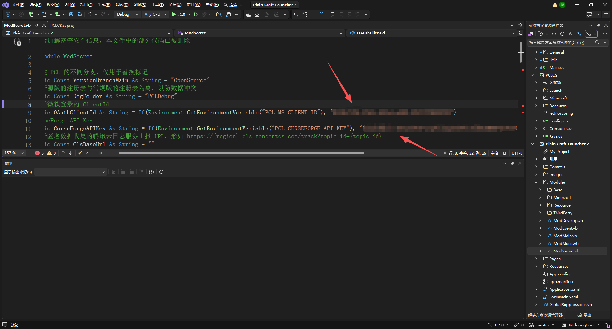

# PCL无法下载mc解决方案

总所周知，PCL在最新正式版不再提供原版游戏的下载服务

对此，有三种解决方案

## 方案一：下载旧版本PCL

[Tags · Meloong-Git/PCL](https://github.com/Meloong-Git/PCL/tags)

在github的release页可以找到往期版本的PCL，下载源代码压缩包，解压后里面会有对应版本的正式版

将其拖出来后可以正常使用

如果已经有旧版本启动器，先不要联网打开，如果打开了提示叫你更新可以直接alt+f4强制关闭或者从任务管理器关闭，重新打开就没有那个弹窗了，这个时候就可以去设置关闭自动更新

注意，如果开PCL一直提示让你更新，可以去PCL文件夹中的Setup.ini填入SystemSystemUpdate:3，意思是关闭自动更新，这样就可以一直用老版本的启动器了

## 方案二：下载PCL-CE版

[Releases · PCL-Community/PCL-CE](https://github.com/PCL-Community/PCL-CE/releases)

得下载[v2.15.0](https://github.com/PCL-Community/PCL-CE/releases/tag/v2.15.0)之前的版本，在最新版的CE版也加入了禁用中国大陆下载原版MC的功能，不过PCL CE版比原版多了一些功能，例如

- **模组加载器支持**：额外支持 **Quilt** 模组加载器。
- **资源下载与管理**：具备**资源收藏夹**功能，并且支持直接下载**资源包**和**光影包**。
- **便捷操作**：可以**识别剪贴板里的资源链接**，方便快速下载。
- **界面与体验**：早期版本曾提供**深色模式**。同时支持**音乐播放的 SMTC 系统控制**，能兼容 Lyricify Lite 等工具。
- **其他工具**：支持**自动安装修改核心**等。
- **联机功能**：登录Natayark账户后可以联机。

一样需要去PCL文件夹中的Setup.ini填入SystemSystemUpdate:3关闭自动更新

## 方案三：下载最新版PCL源代码自己编译

[版本 2.99.0.0 ·Meloong-Git/PCL](https://github.com/Meloong-Git/PCL/releases/tag/2.99.0.0)

下载解压后使用Visual Studio打开里面的项目文件

把PCL-main\Plain Craft Launcher 2\Modules\ModSecret.vb文件中的Public Const RestrictMcDownload As Boolean改为False，即可恢复下载功能

**CurseForge API Key**去[CurseForge for Studios](https://console.curseforge.com/)注册完账号点击就送

**用于微软登录的 ClientId**申请比较复杂，可以直接去找社区现有的id来使用，这里就不多说了

填入后编译该项目，就可以使用了。
