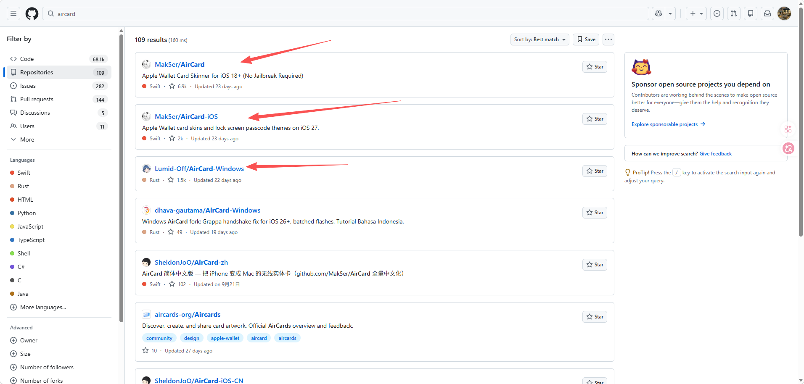
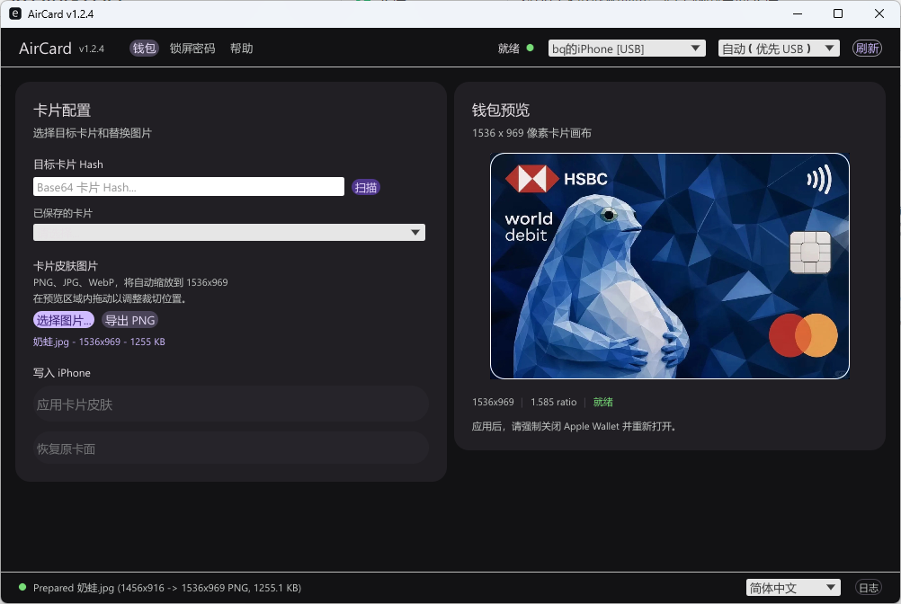
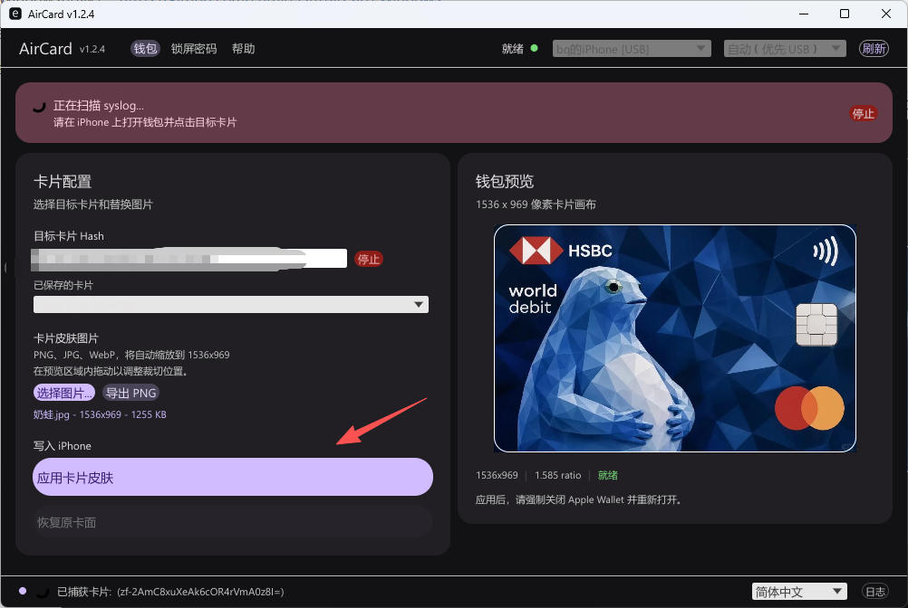
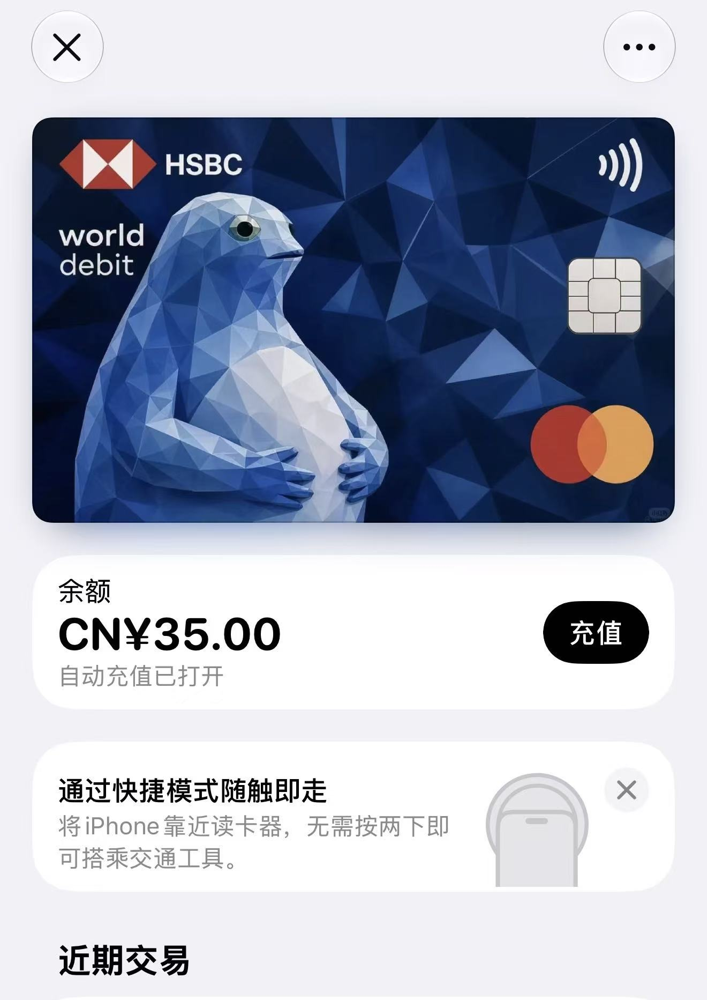

# Apple Pay自定义卡面教程

## 兼容性

| iOS版本                      | 现状     | 注释                                 |
| ---------------------------- | -------- | ------------------------------------ |
| **iOS 18.0 – 27.0.1**        | ✅ 支持   | 对钱包卡皮肤和锁屏密码主题的全面支持 |
| **iOS 27.2 beta 1 – beta 2** | ✅ 支持   | 工作                                 |
| **iOS 27.2 beta 3+**         | ❌ 已修补 | 苹果已经修补了底层漏洞               |

## 注意：请先备份好原卡面！！

Mac电脑可选择https://github.com/Mak5er/AirCard

如果手机上有Sidestore可以选择https://github.com/Mak5er/AirCard-iOS

Windows可选择	https://github.com/Lumid-Off/AirCard-Windows

我这边使用的是Windows的，下载aircard.exe后双击打开，可以在右下角切换成简体中文

接着将手机与电脑连接，右上角连接成功后即可选择卡面图片，没有卡面可以去https://cardart.cc/explore挑选自己喜欢的卡面

点击扫描后打开手机的钱包app，选择卡片，点一下即可被扫到卡片Hash

然后再应用，强制关闭再打开钱包就可以了

