# AppleWatch强开Hermes表盘和Siri AI教程

> 注意：这会更改系统配置文件，有一定风险。**一定要先导出备份**，出问题可以一键恢复。

准备工作： 

电脑下载[GitHub - AdminZachary/WatchBridge](https://github.com/AdminZachary/WatchBridge) 和[GitHub - pookjw/HermesEnabler](https://github.com/pookjw/HermesEnabler/tree/main)

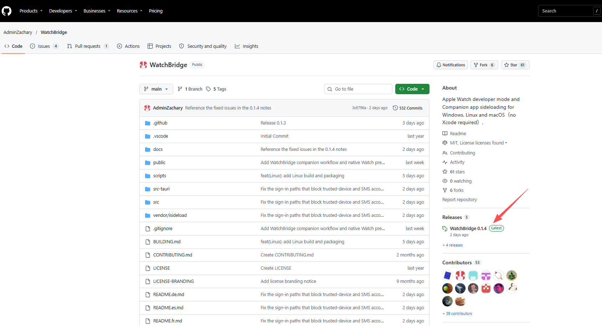

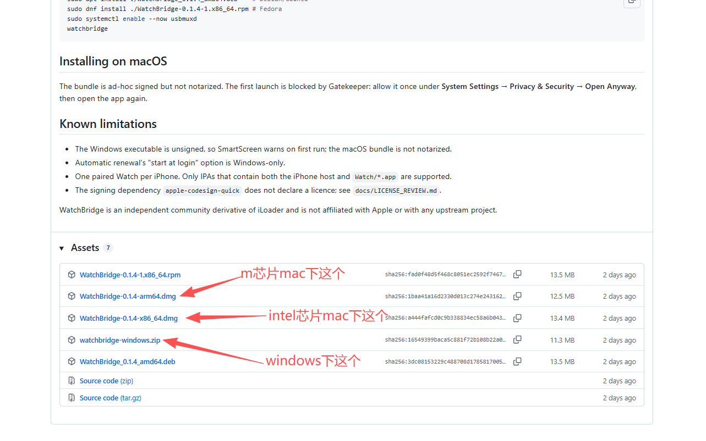

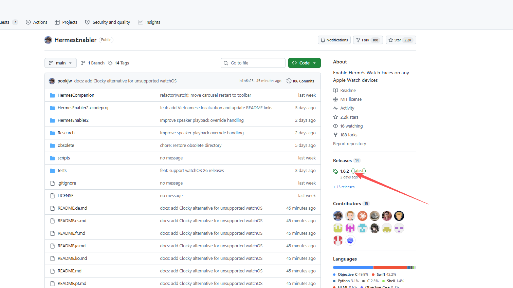

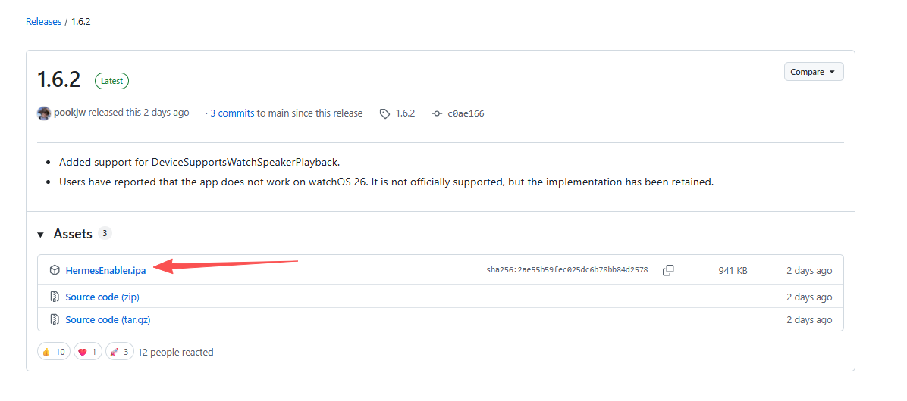

接着将iPhone用线连接着电脑，iPhone、Apple watch、电脑连接至同一个网络（可以用电脑/手机开热点），然后解压WatchBridge，打开

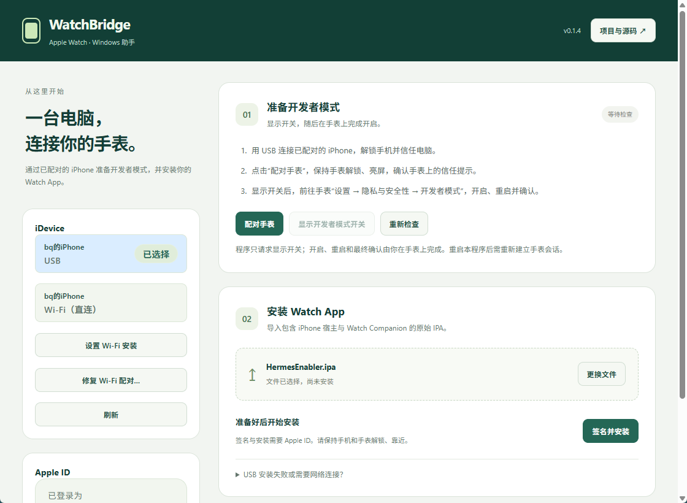

点击配对手表，然后在手表上信任电脑，接着点击显示开发者模式开关，如果没有跳出来，可以去**设置->隐私与安全性->开发者模式**打开，然后输入密码、重启

接着进入第二步02，把HermesEnabler.ipa导入进去，登录自己的Apple ID，然后点击签名并安装，安装完成后去**设置->通用->VPN与设备管理**信任这个软件，就可以打开了

在手机上打开这个软件，同时手表上打开，然后打开watch faces里面的hermes，再返回点击右上角的√，重启后就可以开启Hermes表盘，手机上也能设置表盘

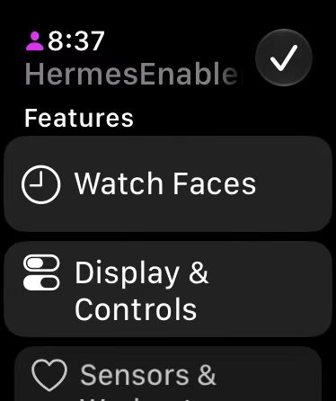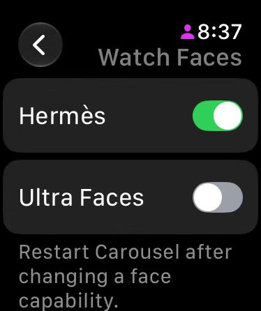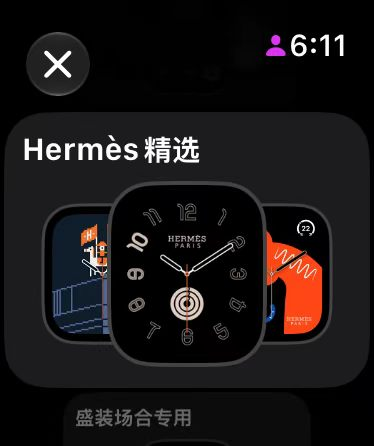

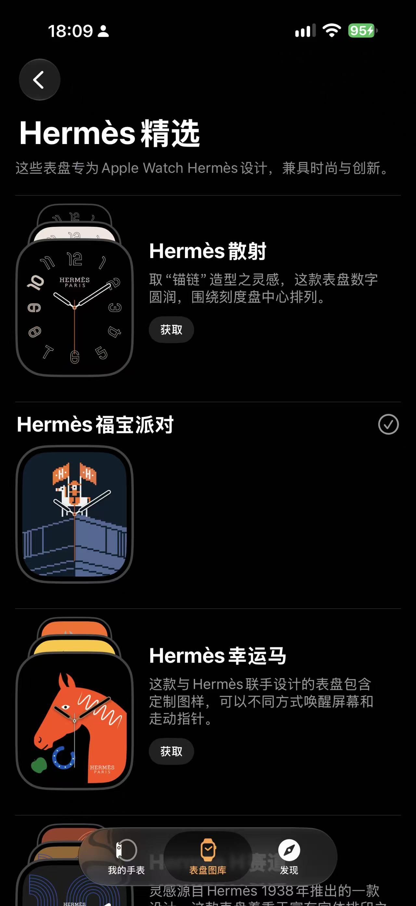

往下划找到Siri&intelligence选项，打开对应选项，即可开启手表上的siri AI（bug有点多，需要多尝试，多折腾一下，且手机上也要开启siri AI才行）

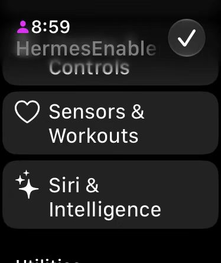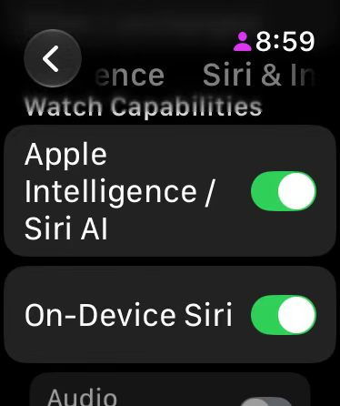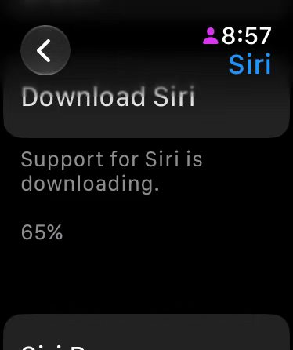