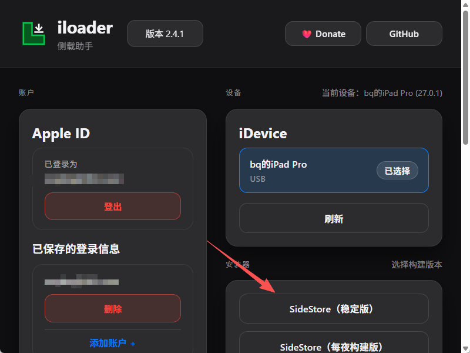
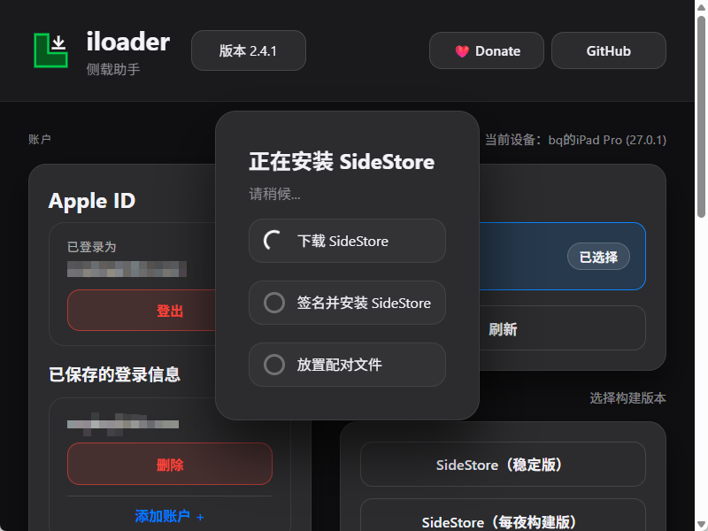
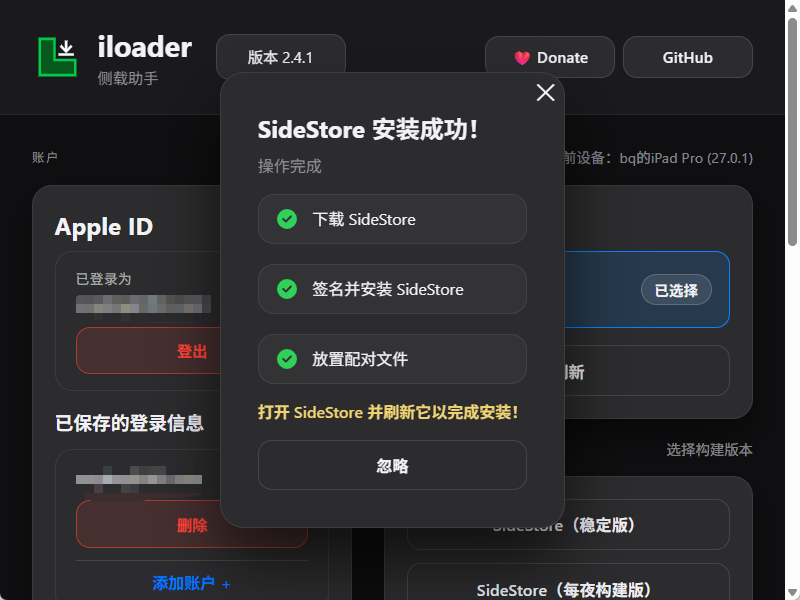
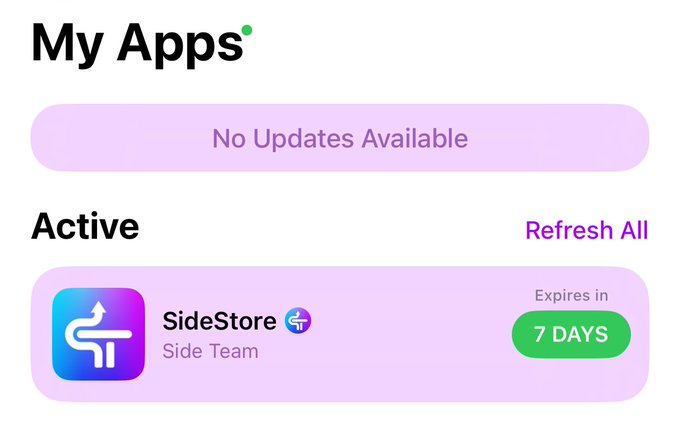
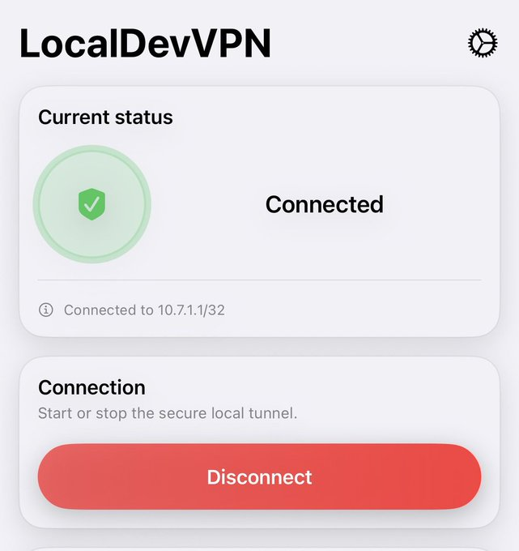
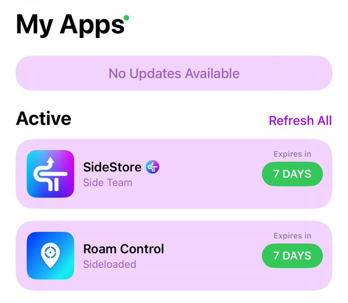
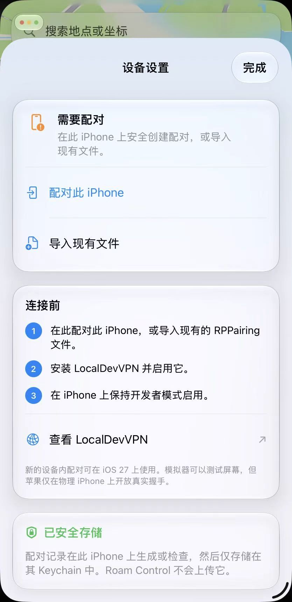
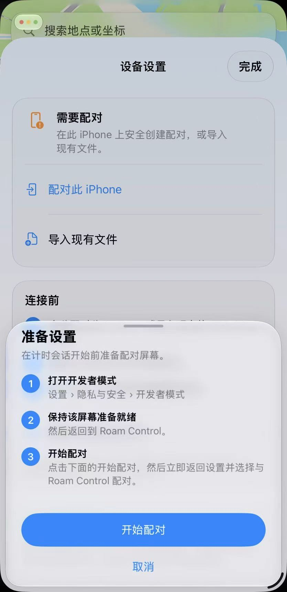
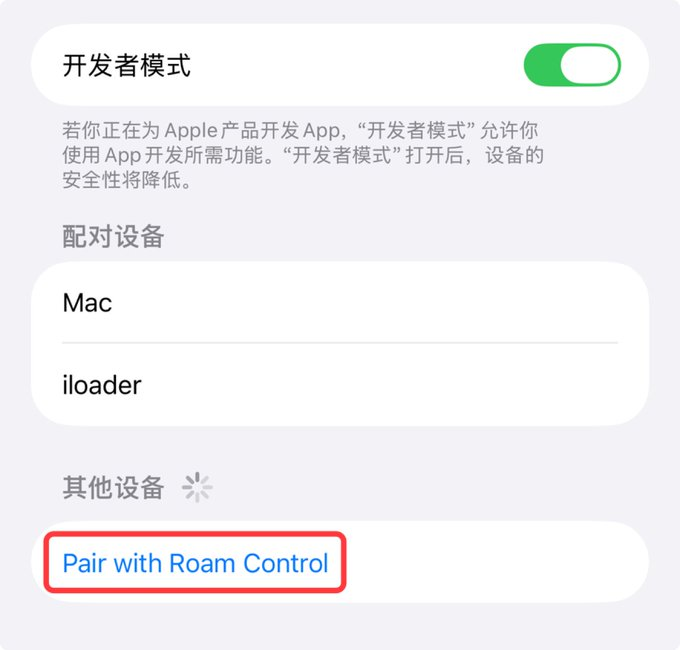
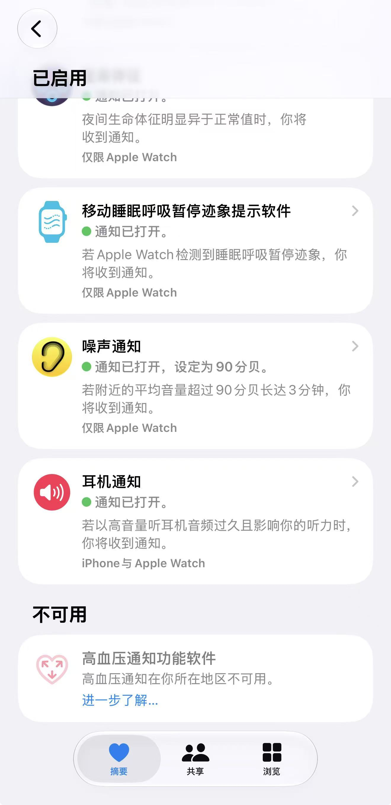

# iOS 定位修改（iOS27版）

过去很多人提到 iPhone 修改定位，第一反应都是：

**WLOC、抓包、MITM、电脑端工具，或者越狱。**

但到了 iOS 27，这套思路已经改变。

**传统 WLOC 社区方案通常通过代理客户端、MITM（中间人代理）和受信任的 CA 证书**，修改 Apple 网络定位服务请求或响应中的位置数据。

这不是直接修改 iPhone 的 GPS 硬件，而是尝试改变系统通过网络获取的位置结果。**从 iOS 27 Beta 6 起**，额外的证书限制阻断了原有定位测试流程。

这意味着即使你重新安装模块、证书和快捷指令，也不代表 HTTPS 定位请求还能被成功拦截、解密和修改。即使日志显示坐标修改成功，系统或目标 App 仍可能继续使用缓存位置，或者通过 GPS、IP 地址、账户地区及服务器端校验判断实际位置。

**新的技术路线**已经演变为了利用**Xcode / 开发者定位模拟** 这类iOS开发者的模拟定位了

**最终我采用的是iLoader + SideStore + LocalDevVPN +RoamControl的方案**

## 两种方案的核心区别

| 对比项                | 旧 WLOC                  | Roam Control 0.9.9 Build 105                         |
| --------------------- | ------------------------ | ---------------------------------------------------- |
| 核心机制              | HTTPS 代理与响应修改     | 开发者配对与模拟定位会话                             |
| 系统要求              | 取决于旧方案及证书兼容性 | iOS 27+、开发者模式                                  |
| 配套组件              | 代理客户端、证书等       | LocalDevVPN                                          |
| 电脑要求              | 通常不需要               | 首次配对流程在 iPhone 上完成，官方说明不要求常驻电脑 |
| 固定坐标              | 支持                     | 支持                                                 |
| 模拟移动              | 取决于旧方案             | 支持步行、驾车、骑行、摇杆和 GPX 路线                |
| 恢复真实定位          | 通过旧方案的恢复流程     | 提供 Stop & Restore                                  |
| 是否保证所有 App 生效 | 否                       | 否                                                   |

RoamControl仓库：https://github.com/seanhowarthdev/Roam-Control

**大概流程如下：**电脑安装SideStore并侧载到手机上-->手机开启开发者模式-->手机下载LocalDevVPN -->自签安装RoamControl

## 电脑安装SideStore

官网：[iloader - 免费开源iOS侧载辅助工具](https://iloader.app/) Github仓库地址：https://github.com/nab138/iloader/releases

选择对应电脑版本的下载后安装，打开 iloader 之后：

- 登录一个 **Apple Account，也就是 Apple ID**。
- 这个 Apple ID 不要求必须和 iPhone/iPad 当前登录的 iCloud 账号一样。
- 选中你的 iPhone/iPad，然后完成和手机配对。
- 点击 **Install SideStore (Stable)**。

之后就会进行安装 SideStore 流程了：

等 iloader 提示安装完成后，iPhone/iPad 里面会出现一个 **SideStore** 应用，现在打开还会提示没有权限。

按步骤操作：

- iPhone/iPad 打开 **设置 > 通用 > VPN 与设备管理**。
- 找到 “**开发者 App**” 下面你刚才登录 iloader 的 Apple ID。
- 点进去对应的 Apple ID，然后选择 **信任**。
- 再打开手机里面的 **SideStore**。
- 在 SideStore 的 Settings 里面再使用同一个 Apple ID 登录。

然后在 SideStore 的 My Apps 页面，你也能看到 **SideStore 7 DAYS**：

在手机上的Sidestore登录Apple ID（连着电脑的时候点登录会自动登录电脑上那个ID）后可以点击右边的 **7 DAYS**，也可以手动刷新一次 SideStore。

> 免费 Apple ID 签名有效期为 7 天，**但并不是每 7 天都要重新连接电脑安装**，正常情况下，电脑只在第一次安装 SideStore 时需要使用。、

> 后续只需要打开 LocalDevVPN，在 SideStore 中刷新 App，即可重新续到 7 天。

> SideStore 本身也会尝试在后台自动刷新，但如果需要长期修改定位，手动隔几天检查一次会更稳。

> 如果 pairing file 因为系统升级、重置或者 Apple 的原因失效了，才可能需要重新用 iloader 处理。

## 启用开发者模式

打开 **设置** → 下滑找到 **隐私与安全性**。如果没有看到“开发者模式”选项，说明设备尚未安装任何开发者签名的 App，需要先安装Sidestore。

在页面底部找到 **开发者模式** 并点击进入。打开右侧开关（变绿），系统会提示“重新启动设备以打开开发者模式”，点击 **重新启动**。

重启并解锁后，系统会再次弹出确认框“打开‘开发者模式’？”，点击 **打开** 完成设置。

## 安装 LocalDevVPN

首先在 iPhone 手机美区 Apple Store 搜索并安装 **LocalDevVPN** 应用。

安装以后打开它，点击 **Connect** 即可：

第一次会提示 **“允许添加 VPN 配置”**，点 “**允许**”，输入 iPhone 锁屏密码。

> 以后只要你需要在 SideStore 里面**安装 IPA、更新 App、刷新签名、定位**等操作，都要先让 LocalDevVPN 保持连接状态。

## 安装 Roam Control

到这里需要检查三个地方：

- **LocalDevVPN** 能正常 Connect。
- **SideStore** 能正常打开并登录。
- **My Apps** 里的 SideStore 刷新成功，剩余时间接近 7 DAYS。

三个都正常，就说明 SideStore 环境已经彻底搞定，接下来就可以安装 **Roam Control** 了。

打开 Roam Control 的 GitHub Release：

> https://github.com/seanhowarthdev/Roam-Control/releases

下载最新版 .ipa 到 iPhone，然后打开 **SideStore > My Apps > +**，选择刚下载的 Roam Control IPA，等待签名和安装完成。

安装完成之后，Apps 页面会显示 “**Roam Control**” 应用了。

## 配对 Roam Control

现在打开 **Roam Control** 应用，然后完成和手机的配对：

然后打开 iPhone **设置 > 隐私与安全性 > 开发者模式**，点击 “**Pair with Roam Control**” 进行配对：

点击以后，系统会要求输入一个 **6 位数字验证码**，这个验证码会显示在 Roam Control 里面，输入验证码并确认就配对成功了：

## 开始定位

重新打开 **Roam Control**，就可以选择位置并开始定位了

如果想更换位置，**不用点停止，直接选择新的地点**，然后点击 **Update Location** 更新定位即可。

# 常见问题

另外有两个问题需要特别说明一下：

## 1、能不能激活海外手机卡/开通国行Apple Watch高血压功能？

**不行！**

之前 WLOC 方案可以用来配合激活部分海外手机卡，比如：**CTExcel、Tello**

但是这一次的不行，这种方案修改的定位是基于苹果开发者的模拟定位，在定位信息里面会明确标注该定位是模拟的，**用来打卡钉钉会出事，不要去尝试！！！**

Apple Watch我自己实测过也不行，应该和上面的原因一致

## 2、LocalDevVPN 会占用 VPN 通道

这是目前这个方案比较明显的一个限制。

Roam Control 工作时需要 **LocalDevVPN** 保持连接，而 iPhone 一般同一时间只能使用一个 VPN 配置。所以如果你平时还需要在手机上运行 **Shadowrocket、Loon** 之类的工具，就可能产生冲突。

不过这个问题也有解决办法，可以把代理放到**软路由或者旁路由**上，让 iPhone 直接通过 Wi-Fi 使用代理网络，这样手机本身的 VPN 通道就可以专门留给 LocalDevVPN。

所以，如果你本身就有软路由、旁路由环境，这套方案就不存在 VPN 限制。