# iPad运行macOS(虚拟机方案)

准备工作：

1.**系统为iPadOS 27 以上的 iPad。** 并且有足够空间下载 macOS 大约需要40G。

2.**一个外区 Apple 账户。** 港区或美区账户用来下载  [LocalDevVPN](https://apps.apple.com/app/id6755608044)。同一个账户也可以签名，准备好接收验证码。

3.**sidestore侧载工具**（用电脑安装iloader然后侧载）

本次使用到的项目是[Leviidev/Henge：在iOS和iPadOS上模拟macOS](https://github.com/Leviidev/Henge)

## 通过电脑安装SideStore

官网：[iloader - 免费开源iOS侧载辅助工具](https://iloader.app/) Github仓库地址：https://github.com/nab138/iloader/releases

选择对应电脑版本的下载后安装，打开 iloader 之后：

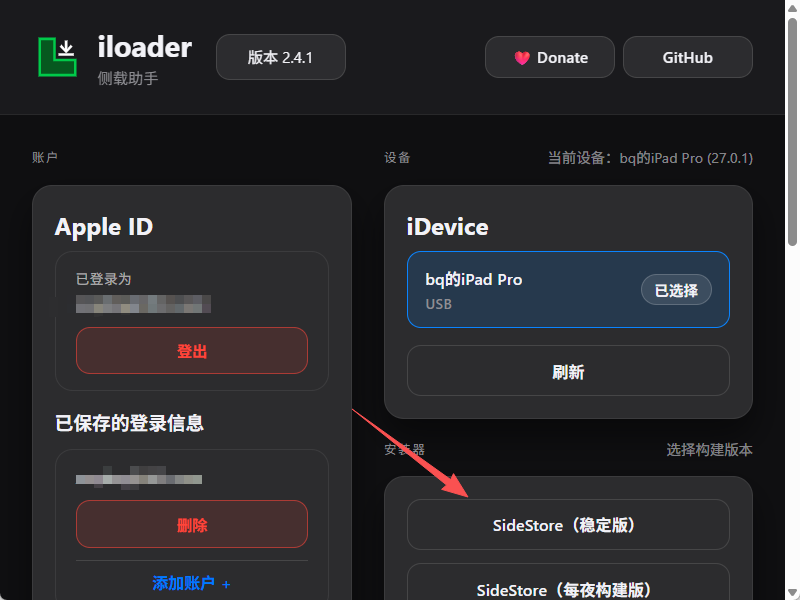

- 登录一个 **Apple Account，也就是 Apple ID**。
- 这个 Apple ID 不要求必须和 iPhone/iPad 当前登录的 iCloud 账号一样。
- 选中你的 iPhone/iPad，然后完成和手机配对。
- 点击 **Install SideStore (Stable)**。

之后就会进行安装 SideStore 流程了：

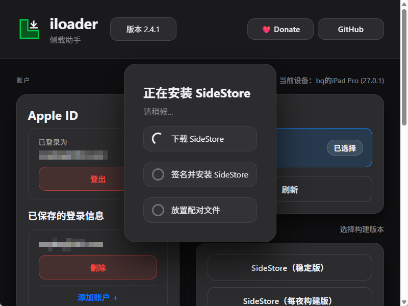

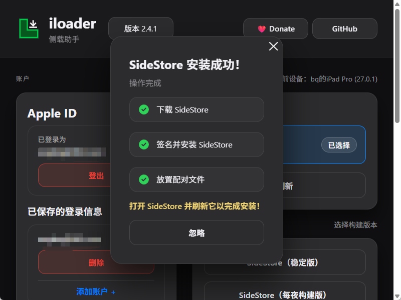

等 iloader 提示安装完成后，iPhone/iPad 里面会出现一个 **SideStore** 应用，现在打开还会提示没有权限。

按步骤操作：

- iPhone/iPad 打开 **设置 > 通用 > VPN 与设备管理**。
- 找到 “**开发者 App**” 下面你刚才登录 iloader 的 Apple ID。
- 点进去对应的 Apple ID，然后选择 **信任**。
- 再打开手机里面的 **SideStore**。
- 在 SideStore 的 Settings 里面再使用同一个 Apple ID 登录。

然后在 SideStore 的 My Apps 页面，你也能看到 **SideStore 7 DAYS**：

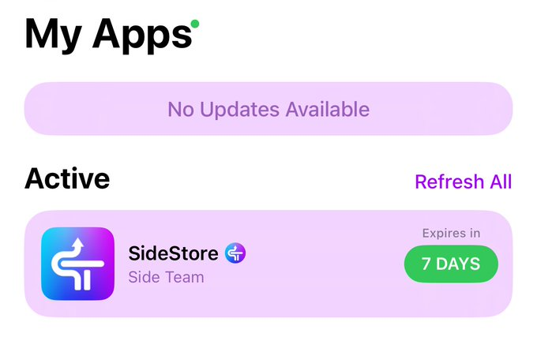

在手机上的Sidestore登录Apple ID（连着电脑的时候点登录会自动登录电脑上那个ID）后可以点击右边的 **7 DAYS**，也可以手动刷新一次 SideStore。

> 免费 Apple ID 签名有效期为 7 天，**但并不是每 7 天都要重新连接电脑安装**，正常情况下，电脑只在第一次安装 SideStore 时需要使用。、

> 后续只需要打开 LocalDevVPN，在 SideStore 中刷新 App，即可重新续到 7 天。

> SideStore 本身也会尝试在后台自动刷新，但如果需要长期修改定位，手动隔几天检查一次会更稳。

> 如果 pairing file 因为系统升级、重置或者 Apple 的原因失效了，才可能需要重新用 iloader 处理。

## 启用开发者模式

打开 **设置** → 下滑找到 **隐私与安全性**。如果没有看到“开发者模式”选项，说明设备尚未安装任何开发者签名的 App，需要先安装Sidestore。

在页面底部找到 **开发者模式** 并点击进入。打开右侧开关（变绿），系统会提示“重新启动设备以打开开发者模式”，点击 **重新启动**。

重启并解锁后，系统会再次弹出确认框“打开‘开发者模式’？”，点击 **打开** 完成设置。

## 安装 LocalDevVPN

首先在 iPhone 手机美区 Apple Store 搜索并安装 **LocalDevVPN** 应用。

安装以后打开它，点击 **Connect** 即可：

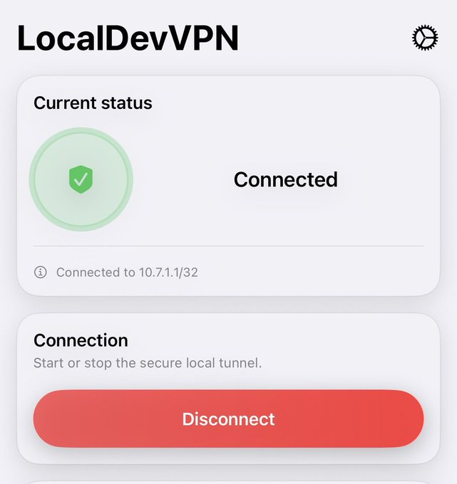

第一次会提示 **“允许添加 VPN 配置”**，点 “**允许**”，输入 iPhone 锁屏密码。

> 以后只要你需要在 SideStore 里面**安装 IPA、更新 App、刷新签名**等操作，都要先让 LocalDevVPN 保持连接状态。

## 安装Henge

打开[Releases · Leviidev/Henge](https://github.com/Leviidev/Henge/releases)，安装最新版的Henge ipa安装包，然后打开LocalDevVPN，打开 **SideStore > My Apps > +**，选择刚下载的 Henge IPA，等待签名和安装完成。

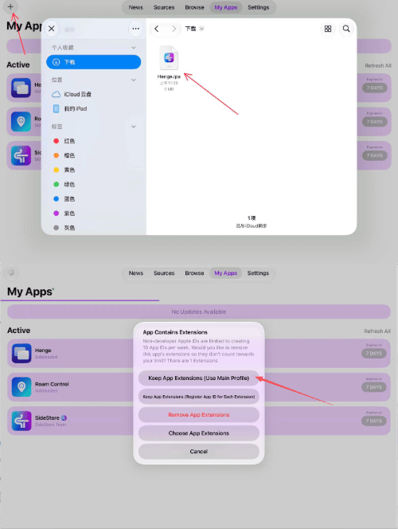

安装完成后，打开Henge的设置，选择打开JIT

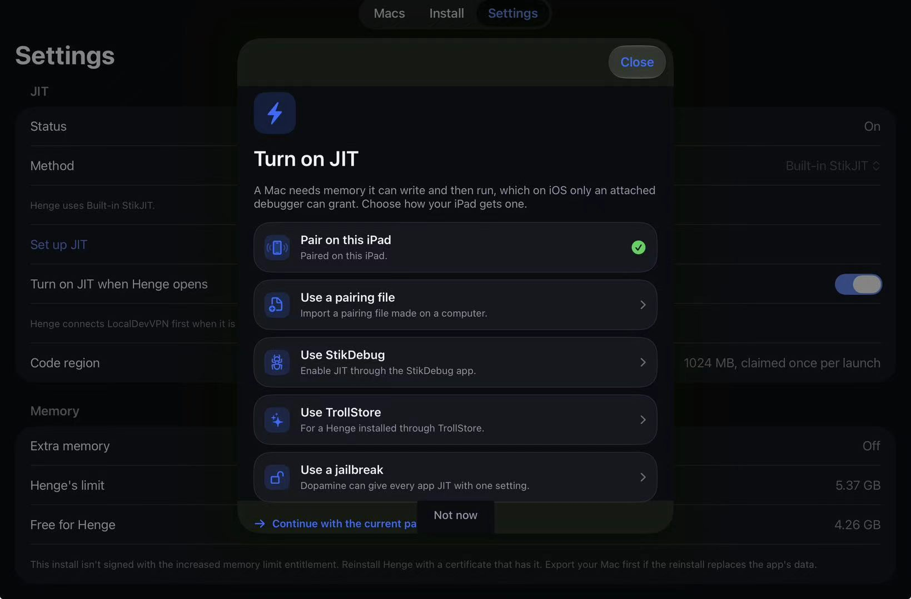

选择第一个pair on this iPad，然后按照提示打开**设置 > 隐私与安全性 > 开发者模式**，点击 “**Pair with Henge**” 进行配对

点击以后，系统会要求输入一个 **6 位数字验证码**，这个验证码会显示在 Henge的通知里面，输入验证码并确认就配对成功了

配对完回到Install选项，选择macOS15.6.1（26和27系统跑起来很卡）下载完成后就可以使用了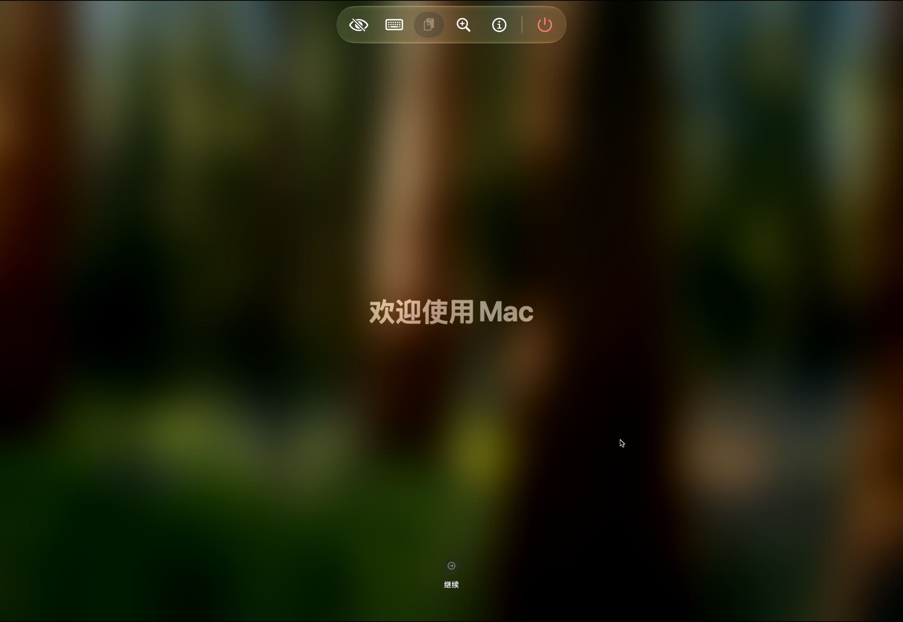

下载过程中如果遇到有网络报错问题，可以尝试开一下梯子来解决，如果是被LocalDevVPN占用了VPN通道的话，可以用电脑或者手机开热点，然后配置热点的代理让连接的热点后一样走电脑的代理即可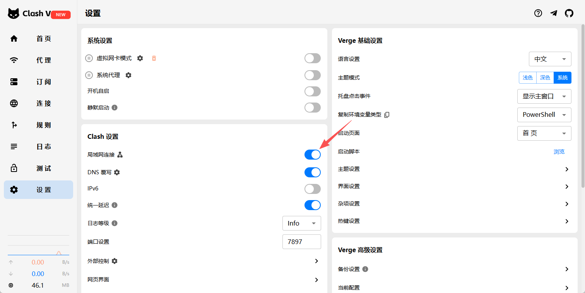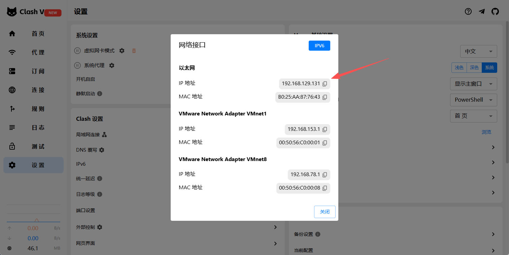

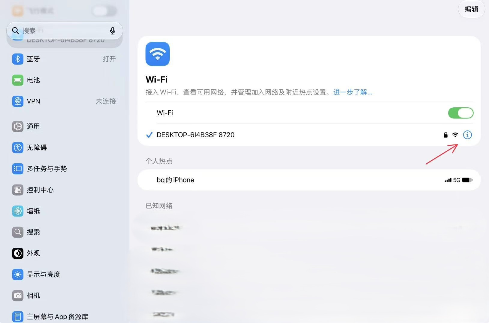

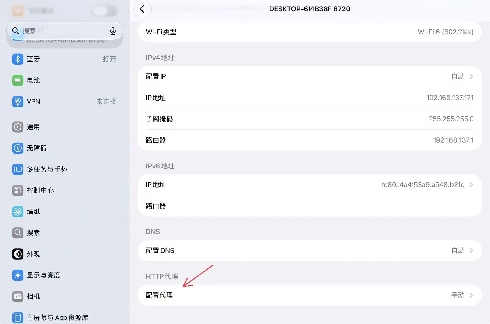

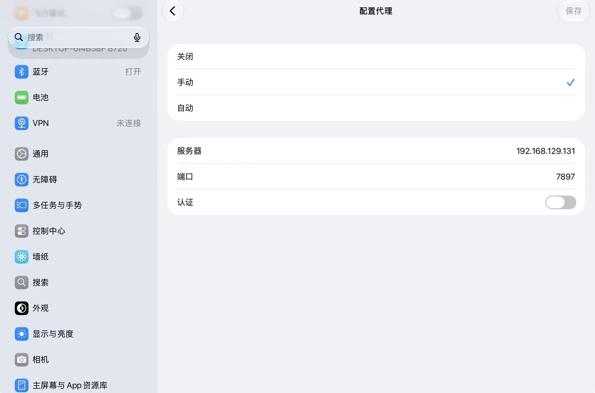

这里的服务器ip和端口就看你的电脑上的局域网ip以及clash的端口即可