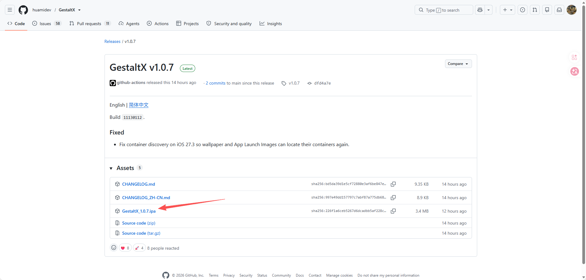
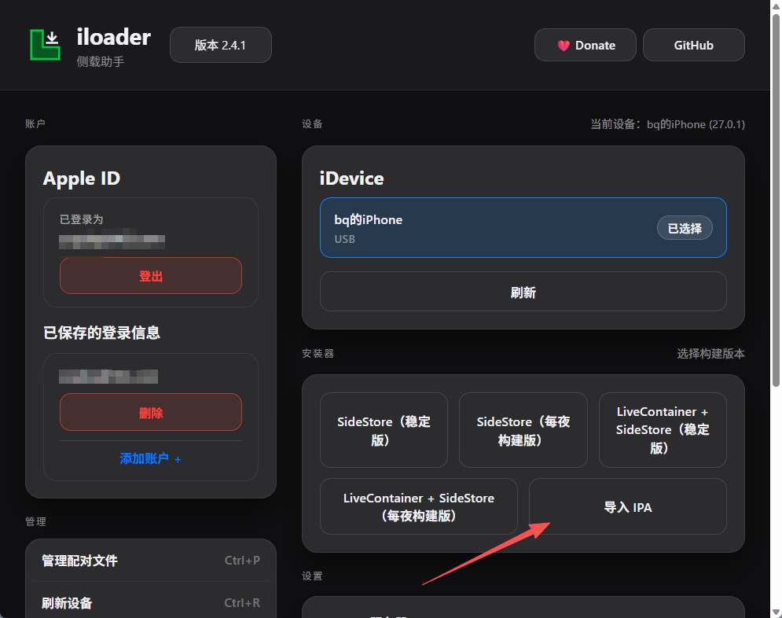
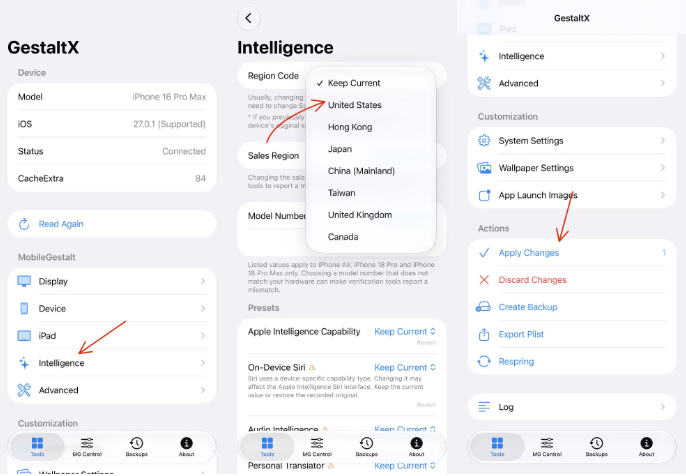
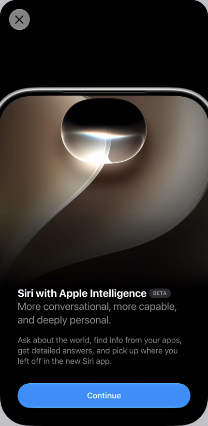
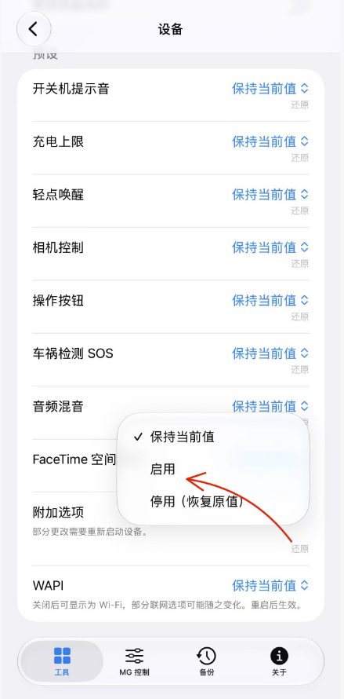

# 国行iPhone iOS27强开SiriAI

网上有人说自签要搞什么企业签名，收几十到上百块。其实用自己的免费 Apple ID在自己电脑上就能搞定了，没必要买企业签

> 这是改系统配置文件，有一定风险。**一定要先导出备份**，出问题可以一键恢复。

准备工作： 

App Store 和系统设置中的 Apple 账户均登录美区 ID。 系统地区设置为美国（只要是支持SiriAI的地区就行），系统语言及 Siri 语言均选择英语（美国）（不选英语的话就是旧版的Apple Intellienge）。 如果是iOS27.3beta1的话就直接把系统语言选择繁体中文（iOS27.3beta1的SiriAI支持繁体中文）就行了。

准备稳定的网络环境， 签名安装 GestaltX，我使用的是 1.0.7 版本（写该文章时的最新版）。 建议：操作前先备份设备，并保存原始配置文件，避免修改失败后无法恢复。

本次使用的项目来源是[huamidev/GestaltX: An MobileGestalt editor for iOS 27.x.](https://github.com/huamidev/GestaltX)

使用的侧载工具是iloader官网：[iloader - 免费开源iOS侧载辅助工具](https://iloader.app/) Github仓库地址：https://github.com/nab138/iloader/releases

首先去github上下载最新版的GestaltX ipa安装包

然后在iloader官网选择对应电脑版本的下载后安装，打开 iloader 之后登录自己的Apple ID，连上自己的设备：

导入IPA，选择刚刚的GestaltX安装包安装到手机上（要是有其他的ipa侧载需求的话可以顺带在这里下载sidestore）

等 iloader 提示安装完成后，iPhone/iPad 里面会出现一个 **GestaltX** 应用，现在打开还会提示没有权限。

按步骤操作：

- iPhone/iPad 打开 **设置 > 通用 > VPN 与设备管理**。
- 找到 “**开发者 App**” 下面你刚才登录 iloader 的 Apple ID。
- 点进去对应的 Apple ID，然后选择 **信任**。
- 再打开手机里面的 **GestaltX**。

打开后先检查一下备份，没有的话手动备份一下，然后依次选择智能（Intellienge），然后改地区代码（Region Code）改成美国United States，再回到主界面，点击应用，然后重启手机即可

重启完成后如果打开设置，发现siri还是原版的图标，那就重新去 **GestaltX**再操作一遍，如果最后那个Apply Changes是灰色的说明已经改成功了，没有的话就再应用更改，重启一次，然后再去设置打开，就可以使用了

## 去除esim限制

突破国行iPhone air/duo的esim限制，则是更改附加选项，改为启用，然后应用后重启就可以添加国外的esim了

